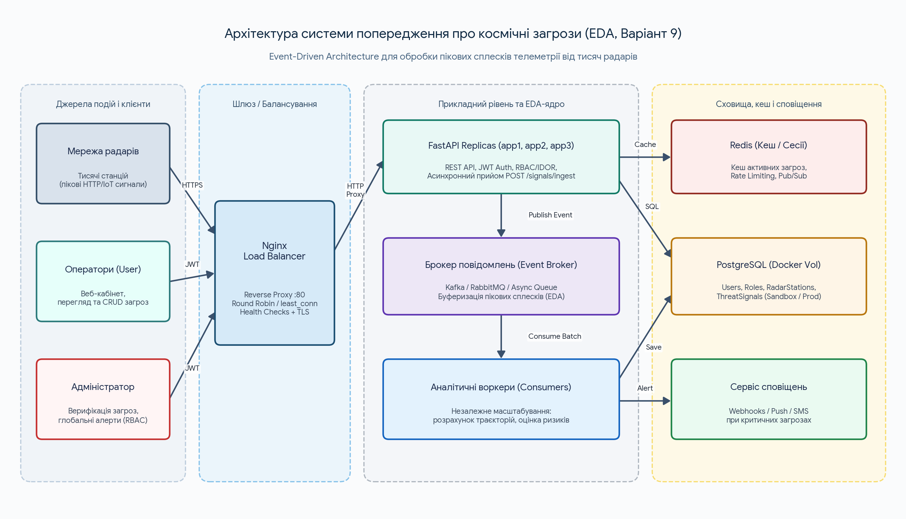
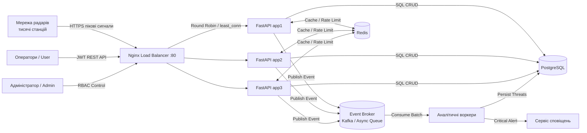

# Архітектура системи попередження про космічні загрози (Варіант 9)

## 1. Обґрунтування вибору предметної області
**Предметна область:** Система попередження про космічні загрози (астероїди, космічне сміття, сонячні спалахи).
**Ключовий сценарій навантаження:** раптові пікові сплески трафіку від тисяч наземних і орбітальних радарів при проходженні метеоритних потоків або сонячній активності.
Синхронна запис-орієнтована архітектура не витримує таких сплесків через вичерпання пулу з'єднань до БД. Тому обрано **Event-Driven Architecture (EDA)**:
- Вхідні радарні сигнали приймаються легкою асинхронною точкою входу (`POST /api/v1/signals/ingest`, відповідь `202 Accepted`).
- Події буферизуються у брокері повідомлень (в MVP — асинхронна черга `InMemoryEventBroker`, у цільовій продакшн-архітектурі — Apache Kafka / RabbitMQ).
- Воркери-споживачі (Consumers) незалежно масштабуються, розраховують рівень небезпеки (`evaluate_severity`) і пакетно зберігають результати в PostgreSQL.

## 2. Графічна схема архітектури

### Mermaid-діаграма взаємодії компонентів

## 3. Технологічний стек
- **Backend:** Python 3.11 + FastAPI (нативна підтримка `async/await` для високого I/O).
- **ORM / БД:** SQLAlchemy 2.0 + PostgreSQL 16 (Production/Docker) та SQLite (Sandbox/Unit tests).
- **Безпека:** JWT (stateless-автентифікація, необхідна для горизонтального масштабування за Nginx), хешування паролів `bcrypt`, RBAC (вертикальне розмежування) + перевірка власника (горизонтальний захист від IDOR).
- **Контроль якості:** `ruff`, `black`, `flake8`, `pre-commit`, `pytest`, GitHub Actions CI.
- **Інфраструктура:** Multi-stage Docker, Docker Compose, Nginx Reverse Proxy & Load Balancer, Locust для навантажувального тестування.
